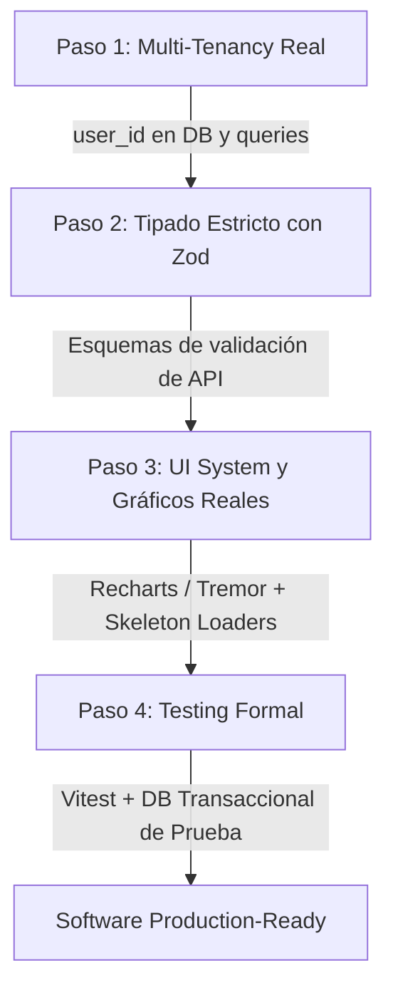

# Auditoría Técnica: Desmantelamiento de «IA Slop» y Plan de Ingeniería

**Proyecto:** `mi-negocio-flujo` / `PruebaA1`  
**Fecha:** Octubre 2026  
**Objetivo:** Erradicar patrones de código generativo de baja calidad (*IA Slop*), restaurar estándares de ingeniería de software en producción y definir la hoja de ruta hacia una arquitectura escalable.

---

## 1. Definición Rigurosa: ¿Qué es «IA Slop» en 2026?

El término **«IA Slop»** (derivado por analogía con el *spam*) describe el código, diseño y artefactos de software generados de forma masiva y no curada por modelos de lenguaje (LLMs), caracterizados por **aparentar completitud mientras esconden atajos críticos de arquitectura, tipos y experiencia de usuario**.

En ingeniería de software moderna, el IA Slop se manifiesta en cuatro dimensiones:

### A. Slop Visual y de Experiencia de Usuario (UI/UX)
* **Estética homogénea («Clon v0 / Cursor»):** Fondo obligatorio `bg-slate-950`, tarjetas con bordes `border-slate-800`, efectos de brillo y paleta neón (`emerald-400` para ingresos, `rose-400` para egresos, `sky-400` para métricas).
* **Sobresaturación de Iconos:** Un icono de `lucide-react` pegado a cada texto sin jerarquía semántica (billeteras, llamas, diamantes, flechas en cada celda).
* **Falsas Gráficas:** Visualización de métricas construida artesanalmente con etiquetas `
` y cálculos inline (`style={{ height: '...%' }}`), en lugar de librerías gráficas vectoriales y accesibles (SVG, Recharts, Tremor).
* **Feedback primitivo:** Mensajes efímeros flotantes manejados con un `useState` y un `setTimeout` manual, carentes de accesibilidad (ARIA) y cola de eventos.

### B. Slop de Tipado y Lenguaje
* **Evasión sistemática de TypeScript:** Proyectos configurados con `strict: true` donde los componentes y servicios usan `any` (`useState<any>(null)`, `params?: any[]`, `Record<string, any>`).
* **Validación ausente en límites del sistema:** Endpoints que reciben `req.json()` sin validación de esquema en tiempo de ejecución (ej. sin Zod).

### C. Slop Arquitectural y de Base de Datos
* **Falsa Arquitectura Multi-Tenant:** Modelos de datos donde no existe la clave foránea `user_id` en las tablas operativas (`movements`, `products`, `reminders`). Todas las consultas son globales (`SELECT * FROM products`), provocando que cualquier usuario autenticado vea y altere los datos de todos los demás.
* **Monolitismo de contexto:** Archivos de más de 1.000 líneas generados de un solo tirón para evitar la gestión de estado entre múltiples archivos.
* **«Falsa Inteligencia» (AI Theater):** Módulos catalogados como «análisis predictivo» o «radar inteligente» que solo ejecutan comparaciones porcentuales estáticas con números mágicos (`* 1.15`).

### D. Teatro de Pruebas (Boilerplate Testing Theater)
* Scripts de consola artesanales con títulos pomposos en ASCII que no usan frameworks estándar (Vitest, Jest), prueban valores quemados (`admin123`, `E2E Perfume Suizo`) y dan una falsa sensación de cobertura técnica.

---

## 2. Diagnóstico Crítico del Repositorio (`PruebaA1`)

### Distinción de Hechos, Inferencias y Opiniones

| Aspecto | Hecho Comprobable | Inferencia Técnica | Veredicto |
| :--- | :--- | :--- | :--- |
| **Multi-tenancy** | No existe `user_id` en `movements`, `products` ni `reminders` en `bd/schema.sql`. | Si se registra un segundo usuario, todos ven la misma caja registradora. | **Falla crítica de diseño (Slop)** |
| **Gráfica de Caja** | Las barras se dibujan con etiquetas `
` y porcentajes calculados en el render. | Inaccesible para lectores de pantalla; no escala si hay valores negativos extremos. | **Slop visual** |
| **Tipado en UI** | Múltiples estados y props estaban definidos como `any`. | La compilación no garantiza la estructura de los datos recibidos. | **Slop de tipado** |
| **Alertas «Inteligentes»** | `alerts.ts` corre 4 consultas SQL que ya no se muestran en el Dashboard principal. | Se consumen conexiones de base de datos en Neon sin ningún beneficio. | **Slop de rendimiento** |
| **Scripts de prueba** | Tres scripts redundantes (`test_suite.mjs`, `test_http_e2e.mjs`, `test_comprehensive.mjs`). | Generados iterativamente durante pruebas de prompting y abandonados en el repo. | **Slop de mantenimiento** |
| **Transacciones SQL** | `bd/connection.ts` usa `withTransaction` con `BEGIN`, `COMMIT` y `ROLLBACK`. | Previene inconsistencias financieras si una venta falla a mitad de camino. | **Ingeniería válida (No es slop)** |
| **Autenticación JWT** | Usa `jose` con HMAC-SHA256 y cookies `HttpOnly` en middleware de Next.js. | El mecanismo criptográfico de sesión es estándar y seguro. | **Ingeniería válida (No es slop)** |

---

## 3. Limpieza Realizada en el Repositorio

1. **Eliminación de scripts duplicados y muertos:**
   * `scripts/test_http_e2e.mjs` (Script abandonado dependiente de `localhost:3002`).
   * `scripts/test_suite.mjs` (Copia obsoleta del verificador de base de datos).
2. **Desacoplamiento de consultas zombis:**
   * Limpieza de `app/api/dashboard/route.ts` para no invocar consultas analíticas ocultas que sobrecargaban la conexión a Neon DB.
3. **Saneamiento de Git:**
   * Removido `tsconfig.tsbuildinfo` del seguimiento del repositorio.

---

## 4. Plan de Acción Técnico para la Erradicación Definitiva

### Fase 1: Base de Datos y Aislamiento por Usuario (Prioridad Alta)
* Migrar `schema.sql` agregando `user_id INTEGER NOT NULL REFERENCES users(id) ON DELETE CASCADE` a `products`, `movements` y `reminders`.
* Modificar cada servicio en `app/modules/*` para requerir `userId: number` como primer parámetro obligatorio.

### Fase 2: Contratos de Datos y Cero `any` (Prioridad Alta)
* Instalar `zod`.
* Crear `lib/schemas/` con la validación de entrada para crear movimientos, productos y recordatorios.
* Rechazar peticiones mal formateadas antes de tocar la base de datos con códigos `422 Unprocessable Entity`.

### Fase 3: Modernización de la Interfaz (Prioridad Media)
* Reemplazar las barras de divs caseras por **Recharts** con `ResponsiveContainer`, `BarChart`, `Tooltip` con formato de moneda y `XAxis` tipado.
* Reemplazar los toasts manuales por `sonner`.
* Implementar Skeleton Screens mientras `fetchDashboard` carga los datos.

### Fase 4: Pruebas Automatizadas Reales (Prioridad Media)
* Instalar `vitest`.
* Reemplazar `scripts/test_comprehensive.mjs` por suites declarativas con aserciones formales (`expect(...)`).
